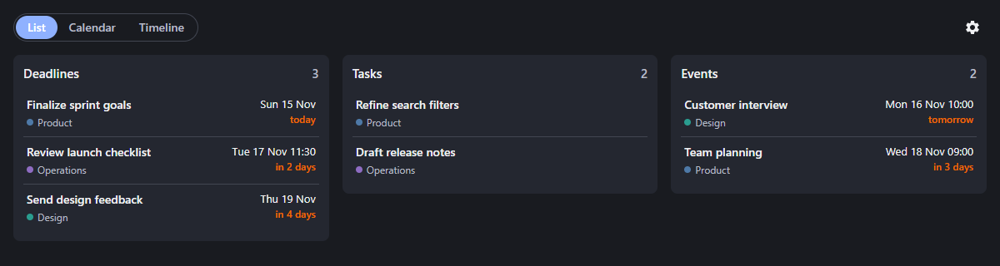

# Deadlines

A Super Productivity plugin with List, Calendar, and Timeline views for deadlines and appointments. It works offline on desktop and mobile.



## Install

Upload `deadlines-plugin-0.0.1.zip` in **Settings → Plugins → Upload Plugin**. Upload it separately on each device. Plugin settings sync across devices.

Appointments are tasks with a planned date or time and no deadline. The default appointment tag is `fixed`; choose another tag in plugin settings if your setup uses a different name. Tasks with deadlines remain deadlines even when tagged.

## Build and test

Requires Node.js 24 or newer:

```sh
npm ci
npm test
npm run test:browser
```

`npm run build` creates the installable ZIP. Browser tests use synthetic tasks; the README screenshot is in `screenshots/`.

## Publish a release

Update the version in `manifest.json` and `package.json`, commit, then push a matching tag such as `v0.0.2`. GitHub Actions checks the build and publishes the ZIP as a GitHub Release asset. Allow Actions to write release contents.

The plugin is licensed under [MIT](LICENSE). Bundled dependency licenses are in `THIRD-PARTY-NOTICES.txt`.

AI agents were used to help write this code.
